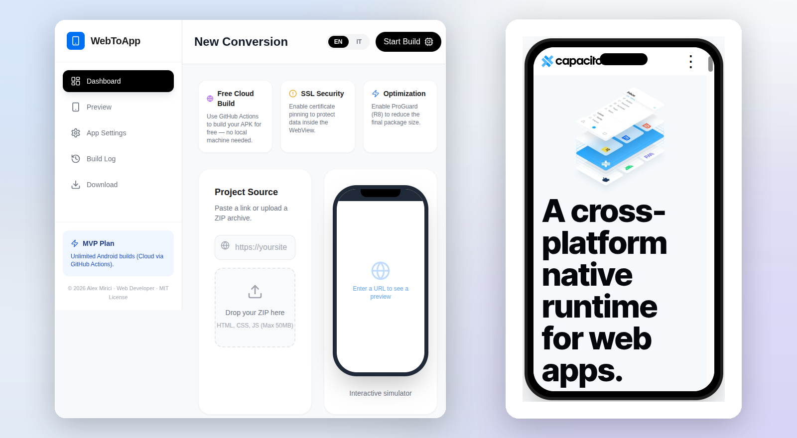
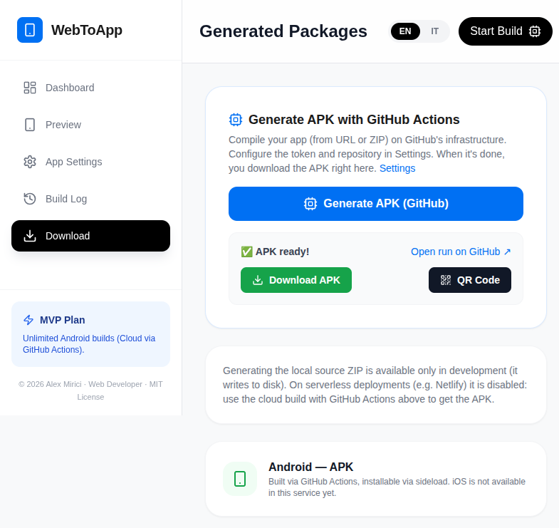

<div align="center">

# WebToApp

### Turn any website into a native Android app — in one click.

[](./LICENSE)
[](#)
[](https://github.com/jeaders/WebToApp/actions/workflows/build.yml)
[](https://alexmirici.netlify.app)

**Copyright © 2026 Alex Mirici — Web Developer.**

<a href="https://webstoapp.netlify.app"></a>

**[🚀 Try it live](https://webstoapp.netlify.app)** · **[🐛 Report a bug](https://github.com/jeaders/WebToApp/issues)** · **[💡 Request a feature](https://github.com/jeaders/WebToApp/issues)**

</div>

---

WebToApp turns **any website** (URL) or **static project** (HTML/CSS/JS ZIP) into an installable **Android APK**. Paste a link, wait a few minutes, download the app.

The site runs inside a native **WebView**, so it works even for sites that block `<iframe>` embedding. The APK is compiled on **GitHub Actions** — free and unlimited for public repositories — so no Android SDK, no local toolchain and no paid build service is needed.

Visitors never enter a token: the GitHub credentials live **only on the server**, configured once by the site owner.

---

## ✨ Features

| | |
|---|---|
| 🔗 **URL mode** | Wrap any live website into a native app. |
| 📦 **ZIP mode** | Package a static site (HTML/CSS/JS) as an offline-capable app. |
| ⚡ **One-click build** | The visitor only pastes a link or drops a ZIP. |
| 👀 **Smart preview** | Interactive `<iframe>` when the site allows it, automatic screenshot when it sends `X-Frame-Options: DENY` / `frame-ancestors 'none'`. |
| 📱 **QR install** | Scan a QR code and download the APK straight to the phone, from any device. |
| 🏷️ **Version & build number** | Set `versionName` and `versionCode` from the dashboard (`1.2.3`, `42`, …). |
| 🕵️ **Custom User-Agent** | Append your own UA string to the WebView (applied natively via Capacitor). |
| 🎨 **Icons & splash** | Android densities generated automatically from a single 1024×1024 artwork. |
| 📲 **Installable PWA** | The dashboard itself can be installed as an app. |
| ☁️ **Signed release** | Release APK **and** AAB when signing secrets are configured, debug fallback otherwise. |
| 🔐 **Server-side token** | No credentials in the browser, no secrets in the repo. |
| 🛡️ **Anti-abuse** | Max 4 concurrent builds and 40 builds/hour protect the Actions quota. Beyond that, requests are **queued** and processed automatically when resources become available. |

---

## 📸 Screenshots

<div align="center">



*Build finished — download the APK, or scan the QR code and install it straight on your phone.*

</div>

---

## 🧠 How it works

```
Visitor (browser)
   │  pastes a URL / drops a ZIP
   ▼
Dashboard (Next.js on Netlify or Vercel)
   │  dispatches a workflow with a server-side GitHub token
   ▼
GitHub Actions ── Capacitor project + Android build (Gradle)
   │
   ▼
Artifact (.apk / .aab) ── streamed back by the dashboard, also via QR code
```
Se la quota Actions è esaurita, la richiesta viene **messa in coda** ed elaborata automaticamente non appena diventano disponibili risorse (build simultanee o quota oraria). Il frontend può monitorare lo stato tramite `/api/cloud-latest`.

The dashboard host **does not compile anything**: it only serves the UI and triggers the workflow. Compilation always happens on GitHub Actions.

---

## 🚀 Using it (visitor)

1. Open **[webstoapp.netlify.app](https://webstoapp.netlify.app)**.
2. Paste a **URL** or drop a **ZIP** with your site.
3. *(Optional)* **App Settings** → name, **package ID**, version, build number, User-Agent, icon.
4. Press **Start Build**.
5. When the build is green you land on **Download**: grab the **APK** or scan the **QR code** with your phone.

> Typing `example.com` is enough — the URL is normalized to `https://example.com`.

> 🆔 **Package ID** is what makes Android see two apps as different. The dashboard generates one from your site (`com.webtoapp.<site>`); if two builds share the same ID, the second is installed as an **update** of the first and replaces it. Change it before building a *different* app, and keep it stable to ship updates of the *same* app.

---

## ⚙️ Configuration (site owner — one time)

Create a **classic Personal Access Token** with the **`repo`** and **`workflow`** scopes, then set two environment variables on your host:

| Variable | Value |
| --- | --- |
| `WEBTOAPP_GITHUB_TOKEN` | Your GitHub PAT — **secret, server-only** |
| `WEBTOAPP_GITHUB_REPO` | `owner/repo`, e.g. `jeaders/WebToApp` |

Where to set them:

- **Vercel:** *Project → Settings → Environment Variables*
- **Netlify:** *Site settings → Build & deploy → Environment → Environment variables* (scope **All scopes**)

Redeploy and open `/api/config`: it must return `{"configured":true,...}`. From then on the token fields disappear from the UI and visitors only paste a link.

> 🔁 **Anti-abuse:** any visitor can start a build on your account, so the service enforces **4 concurrent builds** and **40 builds/hour**. Beyond that, requests are **queued** and processed automatically when GitHub Actions capacity becomes available, then the build resumes.
>
> 🧪 For local development copy `.env.example` to `.env` (git-ignored) and fill the same two variables.

---

## 🖥️ Local development

**Requirements:** Node.js 18+ (20/22 recommended). No Android SDK needed.

```bash
npm install
npm run dev
# http://localhost:3000
```

Production build:

```bash
npm run build && npm start
```

---

## ☁️ Deployment

APK compilation is **independent of the dashboard host**. The dashboard can run anywhere that supports Next.js API routes:

**Vercel — recommended (free Hobby plan, no badge)**
1. [vercel.com](https://vercel.com) → **Add New → Project** → import the repo.
2. Framework: **Next.js** (auto-detected).
3. Add `WEBTOAPP_GITHUB_TOKEN` and `WEBTOAPP_GITHUB_REPO`.
4. Deploy — every push to `main` redeploys automatically.

**Netlify**
- Connect the repo; each push to `main` deploys automatically.
- ⚠️ On the free plan, when credits run out the site is paused until the monthly reset. The APK build is **not** affected: you can still run the workflow from GitHub → **Actions → Build Mobile Apps → Run workflow**.
- ℹ️ The free plan may inject a "Powered by Netlify" badge on the page.

**Serverless notes**
- ✅ Cloud builds (URL and ZIP) work on both hosts.
- ⚠️ The local "source ZIP" generator is disabled on serverless (read-only filesystem); only the cloud build is available.
- ⚡ API routes answer immediately, so host function timeouts are never hit.

---

## 🔏 Release signing & app icons

The workflow builds a **signed release APK** (and an **AAB**, the format required by Google Play) when these **GitHub Actions secrets** are present:

| Secret | Value |
| --- | --- |
| `ANDROID_KEYSTORE_BASE64` | base64 of your `.jks` / `.keystore` file |
| `ANDROID_KEY_ALIAS` | key alias (e.g. `webtoapp`) |
| `ANDROID_KEYSTORE_PASSWORD` | keystore password |
| `ANDROID_KEY_PASSWORD` | key password |

Without them the workflow safely falls back to a debug build, so the pipeline never breaks.

**Icons & splash:** the artwork lives in [`assets/icon.png`](./assets/icon.png) (1024×1024) and [`assets/splash.png`](./assets/splash.png) (2732×2732); `@capacitor/assets` renders every Android density at build time.

> 🔐 **Keep the keystore and its passwords in a safe place** — never in the repository. The same key is required to publish updates to an app already on the Play Store.
>
> ℹ️ **Install warning:** a properly signed APK removes the "unknown app" warning caused by broken signatures. Google **Play Protect** may still show a generic notice for brand-new sideloaded apps until they gain reputation — that is normal outside the Play Store.

---

## 🔒 Security & privacy

- The GitHub token lives **only on the server** (environment variable) and is **never** sent to the browser.
- No token or secret is committed: `.env*`, `*.local.md`, `*.local.jks`, `*.keystore` and generated folders are git-ignored.
- The preview endpoint (`/api/embed-check`) refuses private/loopback addresses (SSRF protection) and only accepts `http`/`https`.
- If a token is ever exposed, revoke it immediately in GitHub → *Settings → Developer settings*.

---

## 🗂️ Project structure

```
.github/workflows/build.yml            # Android APK/AAB build (self-contained)
.github/workflows/netlify-deploy.yml   # Optional Netlify build hook
.github/scripts/customize-android.js   # versionName / versionCode / appendUserAgent
src/app/page.tsx                       # Dashboard UI (upload, preview, settings, logs, download)
src/app/layout.tsx                     # Metadata, PWA manifest, Search Console verification
src/components/PwaRegister.tsx         # Service worker registration + install button
src/app/api/github-build/route.ts      # Starts the cloud build (URL or ZIP)
src/app/api/cloud-latest/route.ts      # Finds / follows the workflow run
src/app/api/cloud-status/route.ts      # Run status
src/app/api/cloud-artifact/route.ts    # Streams the APK (POST download + GET for QR)
src/app/api/embed-check/route.ts       # X-Frame-Options / CSP detection (SSRF-guarded)
src/app/api/config/route.ts            # Reports whether the service is configured
src/app/api/build/route.ts             # Local source builder (development only)
src/lib/github.ts                      # GitHub API helpers + server config
src/lib/i18n.ts                        # English / Italian strings
public/manifest.json, public/sw.js     # PWA manifest and service worker
docs/hero.png, docs/download.png    # README artwork (dashboard, Download + QR)
docs/social-preview.png                # GitHub social preview image (1280×640)
```

---

## 🛠️ Troubleshooting

| Problem | Fix |
| --- | --- |
| **"Build cloud not configured"** | Set `WEBTOAPP_GITHUB_TOKEN` and `WEBTOAPP_GITHUB_REPO`, then redeploy. |
| **App shows only "Loading…"** | Should not happen — the workflow verifies the native config and fails loudly. Rebuild the APK. |
| **ZIP build fails** | The archive must contain an `index.html` (at the root or inside a single top-level folder) and stay under ~45 MB. |
| **Old APK crashes on launch** | Regenerate it: builds made before URL normalization (`https://`) could crash on some devices. |
| **Preview is a static screenshot** | The site blocks embedding (`X-Frame-Options` / CSP). The screenshot is intentional; use *Open in a new tab* for the real thing. |
| **QR points to localhost** | You generated it from `npm run dev`. On the deployed site the QR always uses the public domain. |
| **A new app replaces the previous one** | Both share the same **Package ID** (App Settings): Android treats them as the same app. Give each app its own ID — the dashboard does it automatically from the site URL, placeholders like `com.yourname.app` are rejected. |

---

## 📄 License

Released under the **MIT License** — see [LICENSE](./LICENSE).

**Copyright © 2026 Alex Mirici — Web Developer.**

Third-party open-source dependencies (Next.js, React, Capacitor, Tailwind CSS, Octokit, AdmZip, qrcode, …) remain governed by their own licenses.
